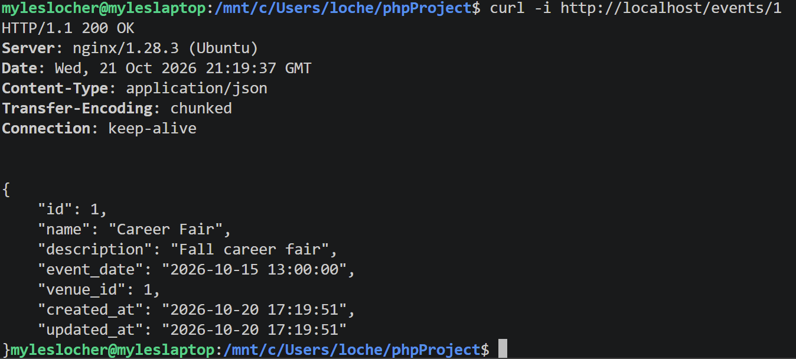

# NGINX Deployment
### Project 1

Student: Myles Locher

---

## Goal

Run and deploy the PHP API through NGINX instead of the built-in PHP server that was being used for development.

---

## NGINX config

```nginx
server {
    listen 80;
    server_name localhost;
    root /mnt/c/Users/loche/phpProject/code;
    index index.php;

    location / {
        try_files $uri $uri/ /index.php?$query_string;
    }

    location ~ \.php$ {
        fastcgi_pass unix:/run/php/php8.5-fpm.sock;
        include snippets/fastcgi-php.conf;
    }
}
```

---

## Starting the server

```bash
sudo systemctl restart php8.5-fpm
sudo nginx -t
sudo systemctl restart nginx
```

---

## Screen Capture

```bash
curl -i http://localhost/events/1
```



